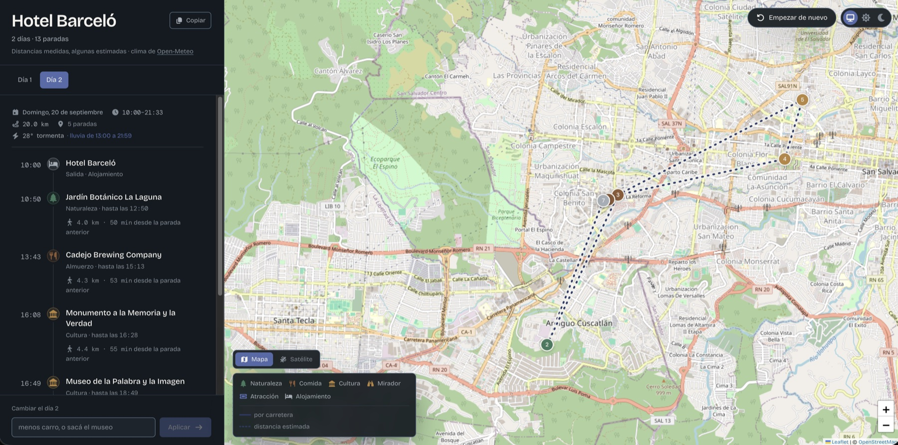
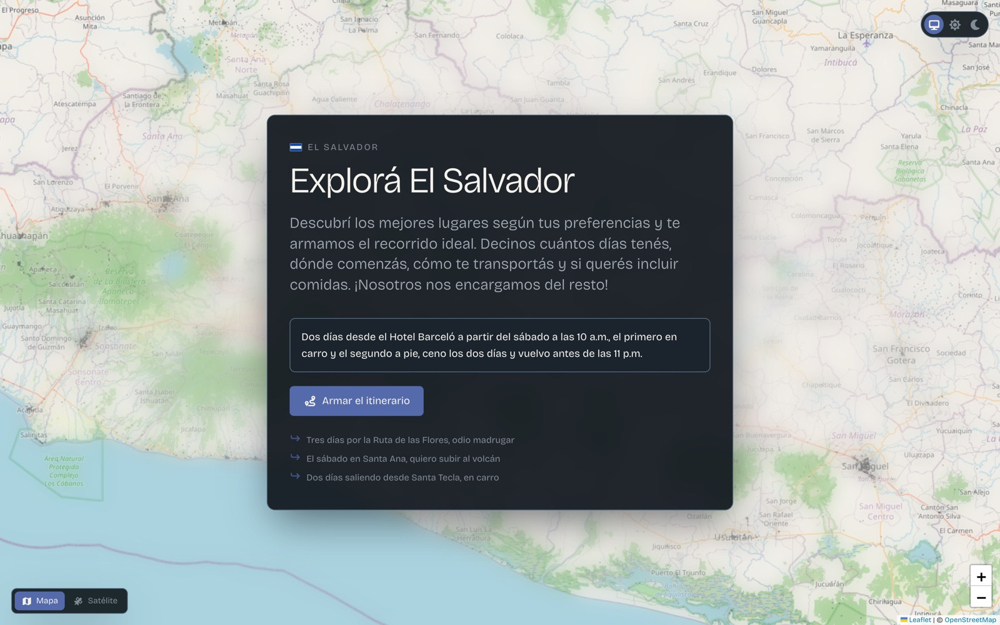

# Waypoint

**Planificador de viajes conversacional por El Salvador.** Escribís en lenguaje
natural lo que querés hacer y el sistema arma un itinerario de varios días sobre
un mapa, con lugares reales, distancias medidas sobre carretera y las
restricciones que pediste hechas cumplir de verdad.

### ▸ [Probar la demo](https://frontend-weld-eta-54.vercel.app/)

[](https://frontend-weld-eta-54.vercel.app/)




---

## Qué hace

Se le escribe una frase y devuelve un itinerario:

> Dos días desde el Hotel Barceló a partir del sábado a las 10 a.m., el primero
> en carro y el segundo a pie, ceno los dos días y vuelvo antes de las 11 p.m.



De ahí sale un plan de dos días con horas de llegada y salida, un día en coche y
otro caminando, cena los dos días, vuelta al hotel antes de las once, y el trazo
por carretera dibujado en el mapa. Lo que **no** pudo cumplir lo dice, con el
número que lo explica.

Entiende, entre otras cosas: la zona o el punto de partida por su nombre, la
fecha, las horas de inicio y fin, un modo de transporte distinto por día, las
comidas y cuánto duran, cuánto tiempo pasar en cada tipo de lugar, categorías
preferidas, exigidas o evitadas, y lugares concretos pedidos por su nombre. El
desayuno hay que nombrarlo —quien viaja suele desayunar donde duerme— y si
además odiás madrugar, el día empieza tarde y no te lo pone. También entiende
qué querés comer: «quiero almorzar hamburguesas» busca una hamburguesería, y
si en esa zona ninguna lo declara, lo dice.

Cada itinerario tiene su propio enlace. Lo guarda el servidor al armarlo —no el
navegador al compartirlo— así que compartir es copiar una URL, y lo que se abre
es ese plan y no uno rearmado. La pantalla de entrada lista los que armaste
antes y los reabre. Cada día se baja al calendario como `.ics`, con un evento
por parada, y cada parada enlaza a Google Maps con el modo de ese día.

El modelo de lenguaje traduce la frase del usuario a restricciones. El motor las
hace cumplir. Esa división es deliberada y es la respuesta al riesgo principal
del proyecto: si el modelo armara el itinerario directamente, «odio madrugar»
sería una sugerencia que a veces ignora. Acá es una hora mínima de inicio que el
algoritmo no puede violar.

Como consecuencia, el motor es determinista y por lo tanto medible: dado un
conjunto de restricciones se puede comprobar automáticamente si el resultado las
cumple. Lo que no se pudo cumplir viaja en la respuesta como violación, con su
magnitud, en vez de esconderse.

---

## Métricas

| Qué | Cuánto |
|---|---|
| Cumplimiento de límites duros | 96% (25 de 26 casos) |
| Lugares inventados | 0 de 334 paradas generadas |
| Factor de desvío medido | 1.45, mediana sobre 812 pares |
| Velocidad efectiva en carro | 35 a 62 km/h según el tramo |
| Pares sin ruta en ORS | 7% (58 de 870) |
| Cupo del endpoint de matriz | 500 / día (plan Standard de ORS) |
| Peticiones por itinerario en zona fría | 1 |
| Tokens por itinerario | 3.246 (3.023 de entrada, 223 de salida) |
| Coste por itinerario | 0,0041 USD — 242 por dólar |
| Coste por revisión de un día | 0,0013 USD — 781 por dólar |
| Lugares en el catálogo | 5.786 activos de 6.449 bajados |
| Descarte del filtro de calidad | 5.9% (370 registros) |
| Duplicados fusionados | 4.4% (274 registros) |
| Comedores con cocina declarada | 41.5% (1.128 de 2.717) |
| Cocinas que el catálogo no sabía traducir | 9% → 3% |
| Días con recomendación de llevar comida | 15% (9 de 62) |
| Repetición de categoría por paso | 26% |
| Aristas medidas por el banco con OSRM propio | 2.678, sin cupo |
| Repetición de subcategoría por paso | 15% |
| Paradas fuera de hora (luz o cierre) | 0 de 240 — ahora medido en el banco |
| Días con pines del mapa superpuestos | 55% → 12% (69 pares → 13) |
| Clicables que anuncian que lo son | 13 de 29 → 28 de 29 |
| Tramos con trazo por carretera | 94% (34 de 36, en los días más duros) |
| Cupo del endpoint de direcciones | 2.000 / día (plan Standard de ORS) |
| Tests | 837 backend, 110 frontend |

El 7% sin ruta son puntos lejos de toda carretera —cumbres de volcanes,
cascadas— que caen a estimación siempre, haya cupo o no. Ese número es también lo
que valida tratar los nulos por celda: con manejo por respuesta se habrían
perdido bloques enteros por una cascada mal ubicada.

---

## Decisiones medidas

Un planificador de viajes es fácil de demostrar y difícil de verificar:
cualquier lista de lugares parece un itinerario. Lo que separa uno bueno de uno
plausible es si cumple lo que se le pidió, y eso se mide.

**Todo el registro de ingeniería está en [DECISIONES.md](DECISIONES.md)** — 70
decisiones, cada una con el fallo concreto que la provocó y el número que la
respalda. Cuatro piezas están ahí documentadas como borradas por no ganarse su
sitio.

Una muestra de lo que hay:

| | |
|---|---|
| [El anochecer era una constante, y la constante estaba mal](DECISIONES.md#el-anochecer-era-una-constante-y-la-constante-estaba-mal) | `DUSK = 18:15` erraba hasta 50 min. El rango real del año es 17:25 a 18:28 |
| [El techo de kilómetros que nadie pidió](DECISIONES.md#el-techo-de-kilometros-que-nadie-pidio) | Un valor por defecto de 25 km pisaba instrucciones explícitas |
| [El nombre con el que la gente llama a un lugar](DECISIONES.md#el-nombre-con-el-que-la-gente-llama-a-un-lugar) | `Multiplaza` no encontraba `Centro Comercial Multiplaza` |
| [La lluvia es la misma regla que la luz](DECISIONES.md#la-lluvia-es-la-misma-regla-que-la-luz-con-otro-insumo) | El umbral que puse primero tiraba el 46% de la lluvia real |
| [El cupo de OpenRouteService es por endpoint](DECISIONES.md#el-cupo-de-openrouteservice-es-por-endpoint-no-uno-solo) | Documenté un número equivocado y la API me corrigió |
| [Repetir categoría cuesta kilómetros](DECISIONES.md#repetir-categoria-cuesta-kilometros) | Tres cerros seguidos no son un día variado |
| [El mismo parque dos veces en un día](DECISIONES.md#el-mismo-parque-dos-veces-en-un-dia) | 34 de 47 km en ir a comer y volver al mismo sitio |

---

## Correr localmente

```bash
cp .env.example .env
docker compose up -d --build
docker compose exec api alembic upgrade head
curl http://localhost:8100/health
```

Un itinerario de dos días en la Ruta de las Flores:

```bash
curl -s -X POST localhost:8100/itinerary \
  -H 'Content-Type: application/json' \
  -d '{"center_lat":13.8697,"center_lon":-89.8467,"days":2,"max_travel_km_per_day":40}'
```

Sin llave de OpenRouteService funciona igual, con distancias estimadas. La
respuesta lo dice en el campo `travel.source`.

Para medir sin cupo ni llave se puede levantar un OSRM propio. El extracto de
El Salvador son 33 MB y el grafo se construye una sola vez:

```bash
make osrm-datos   # baja el extracto y prepara los dos perfiles (~10 min)
make osrm         # levanta un servicio por perfil
```

Después hay que descomentar `OSRM_CAR_URL` y `OSRM_FOOT_URL` en el `.env` y
reiniciar la API. Si están puestas, mide OSRM; si no, ORS. Las dos fuentes
comparten la misma caché, así que cambiar de una a otra no tira lo ya medido.

El clima no necesita ninguna llave: Open-Meteo no la pide para uso no comercial.
Se apaga con `WEATHER_ENABLED=false` y la respuesta lo dice en `weather.reason`.

---

## Guiones

```bash
make test            # los 837 del backend
npm test             # los 110 del frontend, desde frontend/
make ors-check       # verifica la llave y lee el cupo restante (3 de matriz)
make ors-trace       # dice si el trazo por carretera funciona ahora (1 de direcciones)
make ors-calibrate   # mide desvío y velocidad contra el catálogo
make ors-warm        # dice cuanto costaria precalentar; no gasta nada
make ors-warm-apply  # lo hace: 20 peticiones de matriz
make osrm-datos      # construye el grafo de El Salvador, una sola vez
make osrm            # levanta un OSRM propio: mide sin cupo ni llave
```

```bash
docker compose exec api python -m scripts.evaluate        # los 26 casos del banco
docker compose exec api python -m scripts.medir_tokens    # cuánto cuesta una petición
docker compose exec api python -m scripts.medir_horarios  # comidas en comedores cerrados
```

El banco no puede medir los horarios de apertura: sus casos no llevan fecha, y
`opening_hours` habla de días de la semana. `medir_horarios` arma 42
itinerarios con fecha —seis zonas por los siete días— y cuenta cuántas comidas
caen en un sitio que se sabe cerrado. Sale con código distinto de cero si
encuentra alguna, así que también sirve de guardia.

`ors-warm` solo dice cuánto costaría; `ors-warm-apply` lo hace. Son dos
objetivos y no una bandera porque `make ors-warm --apply` **no funciona**: make
se come el `--apply` como opción propia y nunca llega al guion. Con 50
peticiones diarias, un comando que aparenta gastar y no gasta es peor que uno
que no existe.

---

## Stack

| Capa | Elección |
|---|---|
| Backend | Python 3.11 + FastAPI |
| Base de datos | PostgreSQL + PostGIS, migraciones con Alembic |
| Lugares | OpenStreetMap vía Overpass, cargado una vez |
| Nombres de lugar | Nomenclátor de OSM: 3.122 departamentos, municipios, pueblos y barrios |
| Rutas | OpenRouteService: matriz para distancias, direcciones para el trazo |
| Modelo | Claude (Haiku para armar, Sonnet para conversar) |
| Frontend | Next.js (App Router) + React + Tailwind 4 |
| Mapa | Leaflet directo, sin react-leaflet |
| Animación | Motion |
| Iconos | Font Awesome, paquetes SVG con tree-shaking |
| Satélite | Esri World Imagery, sin llave |
| Fotos de zona | Wikimedia Commons, resueltas una vez |
| Tests | pytest en el backend (743), Vitest y Testing Library en el frontend (55) |
| CI | GitHub Actions: migraciones en ambos sentidos, y tipado, lint, tests y build del frontend |

Sin Celery: la carga del catálogo es un guion que corre una vez y la generación
de itinerarios es petición-respuesta. Sin embeddings: la selección de lugares se
resuelve con filtros espaciales y por categoría.

Sin kit de componentes, que impondría su propio aspecto. De Font Awesome se usan
los paquetes SVG de React y no el kit de CSS: el kit trae la hoja y la fuente
enteras, y así entran solo los iconos que se importan. Leaflet se maneja directo
porque `react-leaflet` no se llegó a usar en ninguna parte —el mapa es
imperativo— y quedó como dependencia muerta.

---

## Lo que falta

- **El clima informa y aconseja, pero todavía no decide.** Sabe que llueve sobre
  el mirador de las 15:00 y lo dice; lo que no hace es mover el mirador a la
  mañana.
- **El clima no llega más allá de dieciséis días.** Para más adelante haría
  falta la climatología del archivo histórico.
- **Los horarios de apertura solo sirven para las comidas.** De los destinos
  bajo techo, apenas el 3% trae el dato en OpenStreetMap.
- **Los tests de frontend no cubren el mapa.** Leaflet toca `window` al
  importarse y mide elementos que en jsdom no tienen tamaño. La animación del
  trazo sí se prueba: vive aparte, en un módulo que no necesita Leaflet.
- **El volcado del catálogo no borra.** `make dump` es aditivo, así que un lugar
  retirado en local sobrevive en producción.
- **El OSRM propio es solo local.** El despliegue sigue midiendo con ORS y su
  cupo: llevarlo a producción pide hornear el grafo en una imagen.
- **Los itinerarios compartidos no se borran solos.** La tabla lleva la fecha y
  la cuenta de aperturas para poder limpiarla, pero nadie la limpia todavía.

Para publicarlo, ver [DEPLOY.md](DEPLOY.md). Para el alcance por fases,
[PLAN.md](PLAN.md).

---

## Autor

**Gerardo Amaya** — [github.com/Gerardo-Amaya-dev](https://github.com/Gerardo-Amaya-dev)

<!-- Agregá acá lo que quieras que sea público: LinkedIn, correo personal, sitio. -->

## Datos y licencias

| Fuente | Uso | Licencia |
|---|---|---|
| [OpenStreetMap](https://www.openstreetmap.org/copyright) | lugares, nombres y teselas del mapa | ODbL |
| [OpenRouteService](https://openrouteservice.org/) | distancias por carretera y trazo | usa datos de OSM |
| [Open-Meteo](https://open-meteo.com/en/license) | pronóstico del clima | CC-BY 4.0 |
| [Wikimedia Commons](https://commons.wikimedia.org/) | fotos de zona | cada archivo con su crédito |
| [Esri World Imagery](https://www.arcgis.com/home/item.html?id=10df2279f9684e4a9f6a7f08febac2a9) | capa satélite | sin llave |
